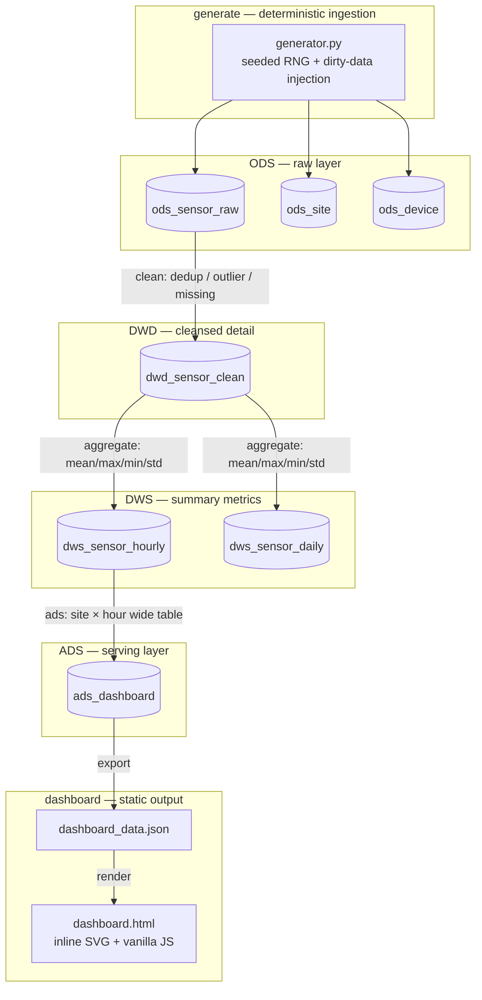

# IoT Sensor Data ETL & Visualization

> 中文定位：一个端到端的 IoT 传感器数据 ETL 与可视化项目——确定性数据采集 → 分层清洗 → 指标集市 → 离线静态看板，运行时零第三方依赖。

An end-to-end IoT sensor data pipeline: deterministic ingestion → four-layer data-warehouse modeling (ODS → DWD → DWS → ADS) → offline static dashboard. Runtime uses only the Python standard library.

## Overview

The project simulates multi-site, multi-device sensor readings, runs them through a layered ETL pipeline, and renders a static dashboard. It is fully reproducible: the same seed and parameters always produce identical generated data and aggregate results.

| Metric | Unit | Valid range |
|---|---|---|
| temperature (`temp`) | °C | −30 … 50 |
| humidity (`humidity`) | %RH | 0 … 100 |
| pressure (`pressure`) | hPa | 870 … 1085 |
| PM2.5 (`pm25`) | μg/m³ | 0 … 500 |

Dirty data (duplicates, out-of-range outliers, missing values) is injected at a small fixed rate so the cleansing step is observable rather than decorative.

## Architecture



## Data layering

A single SQLite database (`output/iot_etl.db`) expresses the four-layer warehouse structure through table-name prefixes.

| Layer | Table | Role | Rows (default scale) |
|---|---|---|---|
| ODS | `ods_sensor_raw` | Raw time-series detail, includes injected dirty data | 651,318 |
| ODS | `ods_site` / `ods_device` | Site and device metadata | 5 / 15 |
| DWD | `dwd_sensor_clean` | Cleansed detail: deduplicated, out-of-range values nulled and flagged | 648,000 |
| DWS | `dws_sensor_hourly` | Hourly mean/max/min/std per site + device | 10,800 |
| DWS | `dws_sensor_daily` | Daily mean/max/min/std per site + device | 450 |
| ADS | `ads_dashboard` | Site × hour cross-device wide table consumed by the dashboard | 3,600 |

- **ODS (raw)** — ingested data as-is. Duplicates, outliers and missing values are preserved here so they can be measured.
- **DWD (cleansed detail)** — deduplicated on the business key `(site_id, device_id, ts)`; out-of-range readings are set to `NULL` and marked in `quality_flag` (`OK` / `OUTLIER` / `MISSING`), never silently dropped.
- **DWS (summary)** — hourly and daily aggregates (`mean` / `max` / `min` / `std`) per site and device.
- **ADS (serving)** — a site × hour wide table that joins site names and cross-device aggregates, shaped for direct dashboard consumption.

## Quick start

**Prerequisites:** Python ≥ 3.10. Runtime has zero third-party dependencies; `pytest` is the only dev dependency.

```bash
# 1. Install the test dependency (optional if you only want to run the pipeline)
pip install -r requirements.txt

# 2. Run the full pipeline (default scale: 5 sites × 3 devices × 60 s × 30 days ≈ 650k rows)
make run
#   equivalent without make:  python -m src.cli run --scale default

# 3. Run the tests
make test
#   equivalent without make:  python -m pytest -q
```

Outputs are written to `output/`:

| File | Description |
|---|---|
| `output/iot_etl.db` | SQLite database with all 7 tables |
| `output/dashboard.html` | Static dashboard (inline SVG, no CDN) — open it directly |
| `output/dashboard_data.json` | Dashboard data (trends + site comparison) |
| `output/data_quality_report.json` | Before/after row counts and anomaly statistics |
| `output/sql_optimization_report.json` | EXPLAIN plans and timing for the SQL benchmark |

Other entry points:

```bash
make run-stress    # stress scale: 10 × 5 × 30 s × 30 days ≈ 4.32M rows
make benchmark     # SQL optimization benchmark only (stress scale)
make clean         # remove output/ and data/
```

## SQL optimization

A representative slow query — *"7-day hourly PM2.5 mean for one site"* — is benchmarked in two versions against the cleansed detail table (~4.32M rows at stress scale). The baseline forces a full-table scan with `NOT INDEXED`; the optimized version adds a composite index and rewrites the query to a range scan.

```sql
-- index
CREATE INDEX idx_dwd_site_ts ON dwd_sensor_clean(site_id, ts);

-- baseline (forced full scan)
SELECT substr(ts, 1, 13) || ':00:00' AS hour, AVG(pm25) AS pm25_avg
FROM dwd_sensor_clean NOT INDEXED
WHERE site_id = ? AND ts >= ?
GROUP BY hour ORDER BY hour;

-- optimized (range scan via index)
SELECT substr(ts, 1, 13) || ':00:00' AS hour, AVG(pm25) AS pm25_avg
FROM dwd_sensor_clean INDEXED BY idx_dwd_site_ts
WHERE site_id = ? AND ts >= ?
GROUP BY hour ORDER BY hour;
```

| Version | `EXPLAIN QUERY PLAN` |
|---|---|
| Baseline | `SCAN dwd_sensor_clean` |
| Optimized | `SEARCH dwd_sensor_clean USING INDEX idx_dwd_site_ts (site_id=? AND ts>?)` |

| Version | Mean time (5 rounds) |
|---|---|
| Baseline | 1.9076 s |
| Optimized | 0.3443 s |
| **Speedup** | **≈ 5.54×** |

The SCAN → SEARCH transition is structural (holds at any scale); the speedup magnitude grows with data size — at the default scale (~650k rows) the same pair measures ≈ 2.7×.

## Testing

14 unit tests cover the three core ETL concerns — deduplication, outlier handling, and aggregation — plus determinism and the SQL benchmark. Run with:

```bash
make test            # or: python -m pytest -q
```

All 14 pass (0.11s). The full functional acceptance suite (18 cases across REQ-01 … REQ-13) is documented in `docs/04-测试报告.md`.

## Project structure

```
iot-etl-dashboard/
├── src/
│   ├── cli.py            # entry point; orchestrates the whole pipeline
│   ├── config.py         # scale presets, seed, sensor definitions, paths
│   ├── generate/         # schema + deterministic ingestion + dirty-data injection
│   ├── etl/              # clean (ODS→DWD), aggregate (DWD→DWS), ads (DWS→ADS)
│   ├── optimize/         # SQL optimization benchmark (EXPLAIN + timing)
│   └── dashboard/        # ADS→JSON export + static HTML render
├── tests/                # 14 unit tests
├── docs/                 # design, PRD, and test report
├── Makefile
├── requirements.txt
└── output/               # generated artifacts (gitignored)
```

## Background

This repository is a reproducible, engineering-grade restatement of the data-engineering work done during an internship on a financial-investment data module: ingesting and cleansing heterogeneous feeds into a lake, building an indicator mart, and using Oracle indexes plus SQL rewriting to speed up a slow BI query by ~50%. The project recreates that methodology end-to-end on a smaller deterministic IoT dataset, so ingestion, cleansing, aggregation, and optimization can all be inspected and reproduced in a single command.
